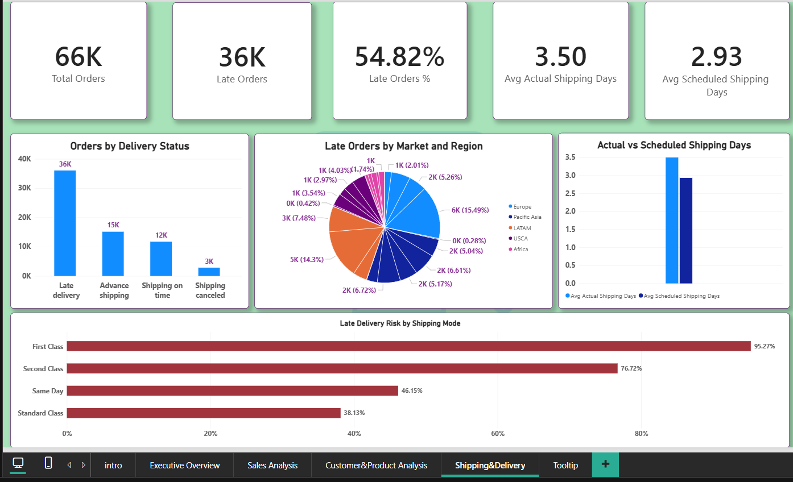

# 📊 Supply Chain & Sales Analytics Dashboard

## Dashboard Pages

### 1. Home Page
The main navigation page of the Supply Chain & Sales Analytics Dashboard, featuring four interactive buttons that allow users to navigate easily between the Executive Overview, Sales Analysis, Customer & Product Analysis, and Shipping & Delivery pages.

[🔗 View Home Page](Home%20Page.jpg)

---

### 2. Executive Overview
Provides a high-level overview of supply chain performance, including key performance indicators (KPIs) such as Total Customers, Total Profit, Total Sales, and Total Orders. It also presents sales trends, regional performance, profit by market, and delivery status, with interactive filters for data exploration.

[🔗 View Executive Overview](Executive%20Overview.jpg)

---

### 3. Sales Analysis
Focuses on sales and profitability across different regions and markets. It includes Profit by Region, Sales by Market, Monthly Sales Trend, and Sales by Order Status, along with Profit Margin and Average Sales per Order KPIs. An interactive Order Status filter allows users to explore sales performance in more detail.

[🔗 View Sales Analysis](Sales%20Analysis.jpg)

---

### 4. Shipping & Delivery
Provides insights into shipping and delivery performance, helping users explore delivery-related metrics and analyze shipping operations.

[🔗 View Shipping and Delivery Dashboard](Shipping_and_Delivery_Dashboard.png)
